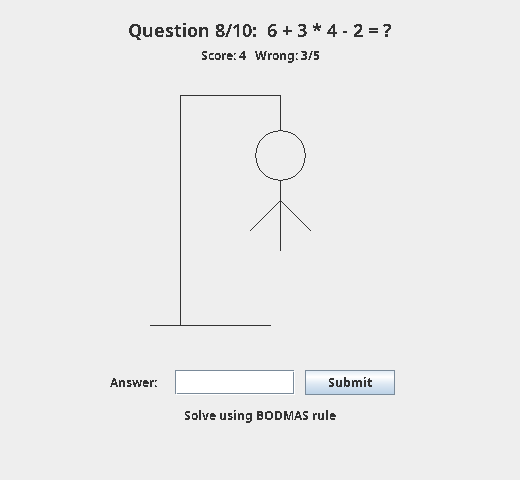

# Math Hangman Game

A Java GUI game that mixes a maths quiz with hangman. The game asks 10 maths questions, and every wrong answer adds one part to the hangman. Five wrong answers and the man is hanged.



## How it works

- Each question has multiple terms using `+`, `-`, `*` and `/`
- Questions are solved using the BODMAS rule (multiplication and division first, then addition and subtraction)
- There are 10 questions in one game
- The hangman is drawn in 5 parts: head, body, arms, legs and face
- 5 wrong answers = game over, finish all 10 with fewer mistakes = you win

## Files

- `Main.java` starts the game
- `GameFrame.java` builds the window and controls the game flow
- `QuestionGenerator.java` creates the questions and calculates answers with BODMAS
- `HangmanPanel.java` draws the gallows and the hangman

## Running the game

```bash
javac Main.java GameFrame.java QuestionGenerator.java HangmanPanel.java
java Main
```

Originally built as my OOP semester project (Spring 2024); rebuilt and documented for this portfolio.
